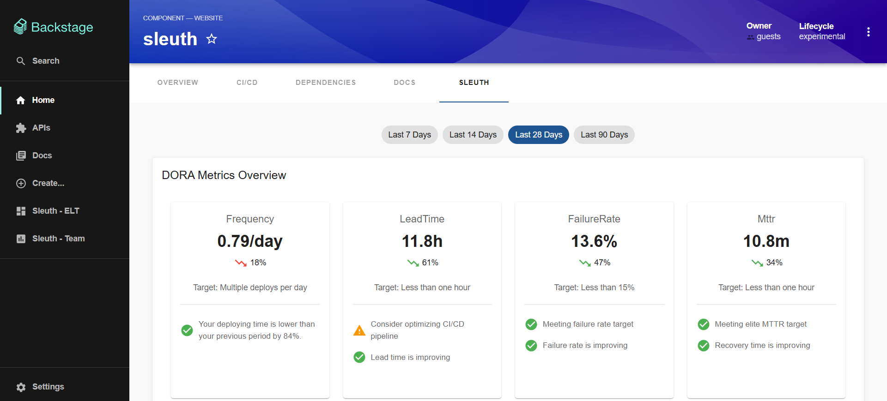
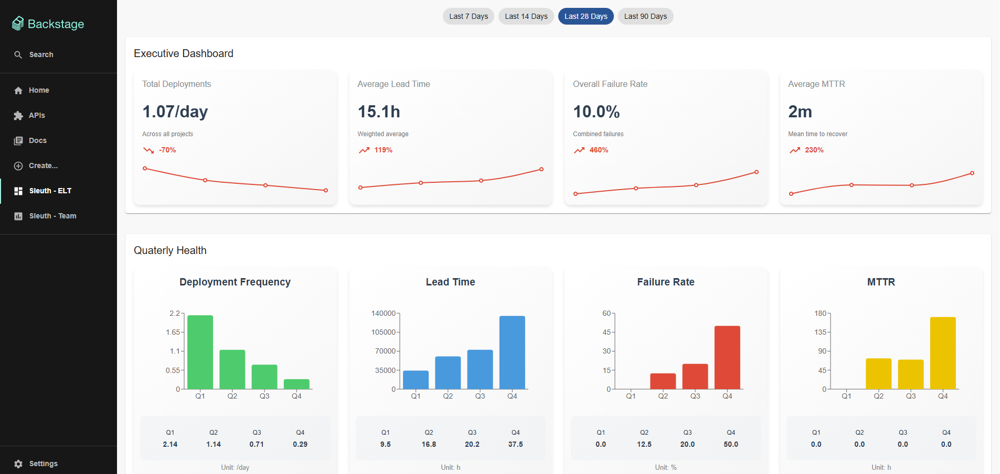
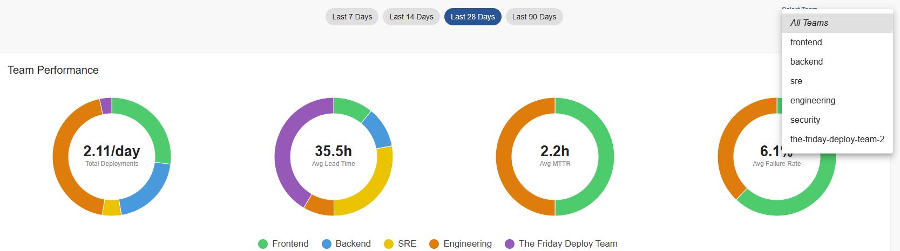
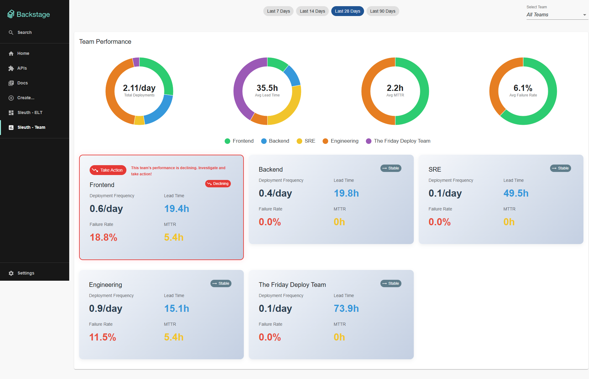
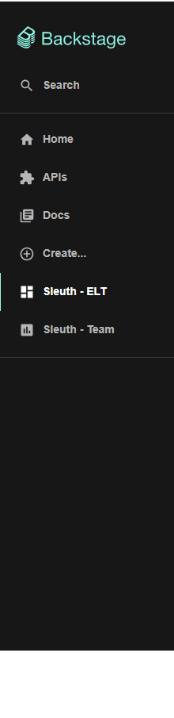

# @backstagerunway/plugin-sleuth-dora

A Backstage frontend plugin that provides DORA (DevOps Research and Assessment) metrics visualization with Sleuth.io integration. This plugin offers three different views for different user roles and use cases.

## Features

- **Executive Dashboard**: High-level organizational DORA metrics and quarterly health overview
- **Lead Dashboard**: Team-focused DORA metrics with team selection and performance tracking
- **Entity Dashboard**: Project-specific DORA metrics embedded in entity pages
- **Time Range Selection**: Configurable time periods for metrics analysis
- **Real-time Data**: Live metrics from Sleuth.io integration

## Prerequisites

- A Backstage application with the [@backstagerunway/plugin-sleuth-dora-backend](../dora-backend) installed and configured
- Sleuth.io account with API access
- Proper configuration in `app-config.yaml`

## Installation

1. Install the frontend plugin in your app package:

```bash
cd packages/app
yarn add @backstagerunway/plugin-sleuth-dora
```

2. Install the backend plugin (required):

```bash
cd packages/backend
yarn add @backstagerunway/plugin-sleuth-dora-backend
```

3. Configure the backend plugin in `packages/backend/src/index.ts`:

```typescript
import { createBackend } from '@backstage/backend-defaults';

const backend = createBackend();

// Add the DORA backend plugin
backend.add(import('@backstagerunway/plugin-sleuth-dora-backend'));

backend.start();
```

4. Add configuration to your `app-config.yaml`:

```yaml
dora:
  sleuth:
    organizationId: 'your-sleuth-organization-id'
    apiKey: 'your-sleuth-api-key-here'
    environment: 'production'          # Optional (frontend-visible)
    # defaultProjectSlug: 'your-default-project'  # Optional; used if entity lacks project-slug annotation
    # apiUrl is optional - defaults to 'https://app.sleuth.io' if not specified
    # apiUrl: 'https://app.sleuth.io'
```

## Available Views

### 1. Entity Dashboard (DoraPerformanceComponent)

**Purpose**: Embeds DORA metrics directly into entity pages for project-specific analysis.

**Features**:
- Project-specific DORA metrics
- Entity-based filtering
- Time range selection
- Performance trends and insights
- Embeddable component for any entity type


*Entity page with Sleuth tab showing project-specific metrics*


**Installation**:

```typescript
// packages/app/src/components/catalog/EntityPage.tsx
import { DoraPerformanceComponent, isSleuthDoraAvailable } from '@backstagerunway/plugin-sleuth-dora';

// Add the component content
const sleuthContent = (
  <Grid container spacing={3} alignItems="stretch">
    <Grid item xs={12}>
      <DoraPerformanceComponent />
    </Grid>
  </Grid>
);

// Add the route to your entity layout
<EntityLayout.Route path="/sleuth" title="Sleuth" if={isSleuthDoraAvailable}>
  {sleuthContent}
</EntityLayout.Route>
```

**Entity Configuration**: To use the Entity Dashboard, your entities can use the following annotations:

```yaml
apiVersion: backstage.io/v1alpha1
kind: Component
metadata:
  name: my-component
  annotations:
    sleuth.io/project-slug: 'your-sleuth-project-slug'  # Required, unless managed globally via dora.sleuth.defaultProjectSlug in app-config
    sleuth.io/code-deployment-slug: 'my-service'        # Optional - defaults to entity name
    sleuth.io/environment: 'production'                 # Optional - defaults to config
spec:
  type: service
  lifecycle: production
  owner: team-a
```

**Fallback Behavior**:
- If `sleuth.io/project-slug` is not specified, it uses `defaultProjectSlug` from app-config.yaml
- If `sleuth.io/code-deployment-slug` is not specified, it uses the entity's `metadata.name`
- If `sleuth.io/environment` is not specified, it uses the `environment` from app-config.yaml

### 2. Executive Dashboard (DoraELTPage)

**Purpose**: Provides executive-level overview of organizational DORA metrics and quarterly health trends.

**Features**:
- Executive summary with key DORA metrics
- Quarterly health overview
- Organization-wide trend analysis
- Time range selection for historical data


*Executive Dashboard showing organizational DORA metrics overview*


**Installation**:

```typescript
// packages/app/src/App.tsx
import { DoraELTPage } from '@backstagerunway/plugin-sleuth-dora';

// Add the route
<Route path="/dora-elt" element={<DoraELTPage />} />
```

```typescript
// packages/app/src/components/Root/Root.tsx
import { CreateComponentIcon } from '@backstage/core-components';

// Add to sidebar navigation
<SidebarItem icon={CreateComponentIcon} to="dora-elt" text="Sleuth - ELT" />
```

### 3. Lead Dashboard (DoraLeadPage)

**Purpose**: Provides team leaders with detailed team performance metrics and the ability to compare teams.

**Features**:
- Team performance overview
- Team selector for comparing specific teams
- All teams view for comprehensive analysis
- Time range selection
- User team filtering based on Backstage catalog


*Team selector dropdown for comparing specific teams*


*Team performance overview with metrics comparison*

**Installation**:

```typescript
// packages/app/src/App.tsx
import { DoraLeadPage } from '@backstagerunway/plugin-sleuth-dora';

// Add the route
<Route path="/dora-lead" element={<DoraLeadPage />} />
```

```typescript
// packages/app/src/components/Root/Root.tsx
import { CreateComponentIcon } from '@backstage/core-components';

// Add to sidebar navigation
<SidebarItem icon={CreateComponentIcon} to="dora-lead" text="Sleuth - Lead" />
```

## Choosing a Setup

The package supports both Backstage frontend systems.

**New Frontend System:** add the plugin as a feature. The two pages, their sidebar entries and the Sleuth tab on service and website components are registered for you.

```typescript
// packages/app/src/App.tsx
import { createApp } from '@backstage/frontend-defaults';
import { doraFrontendPlugin } from '@backstagerunway/plugin-sleuth-dora';

export default createApp({
  features: [doraFrontendPlugin],
});
```

**Legacy frontend system:** mount the pages and the entity tab by hand, as shown in the example below.

## Complete Setup Example (legacy frontend system)

Here's a complete example of setting up all three views:


*Sidebar navigation showing DORA menu items*


### 1. App.tsx Configuration

```typescript
// packages/app/src/App.tsx
import { DoraELTPage, DoraLeadPage } from '@backstagerunway/plugin-sleuth-dora';

// Inside your Routes component
<Routes>
  {/* ... other routes ... */}
  <Route path="/dora-elt" element={<DoraELTPage />} />
  <Route path="/dora-lead" element={<DoraLeadPage />} />
</Routes>
```

### 2. Root.tsx Configuration

```typescript
// packages/app/src/components/Root/Root.tsx
import { CreateComponentIcon } from '@backstage/core-components';

// Inside your Sidebar component
<SidebarItem icon={CreateComponentIcon} to="dora-elt" text="Sleuth - ELT" />
<SidebarItem icon={CreateComponentIcon} to="dora-lead" text="Sleuth - Lead" />
```

### 3. EntityPage.tsx Configuration

```typescript
// packages/app/src/components/catalog/EntityPage.tsx
import { DoraPerformanceComponent, isSleuthDoraAvailable } from '@backstagerunway/plugin-sleuth-dora';

// Add the component content
const sleuthContent = (
  <Grid container spacing={3} alignItems="stretch">
    <Grid item xs={12}>
      <DoraPerformanceComponent />
    </Grid>
  </Grid>
);

// Add the route to your entity layout
<EntityLayout.Route path="/sleuth" title="Sleuth" if={isSleuthDoraAvailable}>
  {sleuthContent}
</EntityLayout.Route>
```

## Configuration

### Configuration Precedence (how values are resolved)

For values used by the UI, the plugin resolves configuration in this order:

1. Entity annotations (if an entity is in context)
2. App config (`app-config.yaml`)
3. Built-in defaults

Keys and their resolution:
- `projectSlug`: `sleuth.io/project-slug` → `dora.sleuth.defaultProjectSlug` → `sleuth`
- `environment`: `sleuth.io/environment` → `dora.sleuth.environment` → `production`
- `codeDeploymentSlug`: `sleuth.io/code-deployment-slug` → entity `metadata.name` (no app-config fallback)
- `defaultTimeRange`: `dora.sleuth.defaultTimeRange` → `last28days`

### Required Configuration

The plugin requires the following configuration in your `app-config.yaml`:

```yaml
dora:
  sleuth:
    organizationId: 'your-sleuth-organization-id'
    apiKey: 'your-sleuth-api-key-here'
    environment: 'production'          # Optional (frontend-visible)
    defaultProjectSlug: 'your-default-project'  # Optional (frontend-visible)
    # apiUrl is optional - defaults to 'https://app.sleuth.io' if not specified
    # apiUrl: 'https://app.sleuth.io'
```

### Entity Annotations

For the Entity Dashboard to work, your entities can use these annotations:

```yaml
metadata:
  annotations:
    sleuth.io/project-slug: 'your-sleuth-project-slug'  # Required
    sleuth.io/code-deployment-slug: 'your-service'      # Optional - defaults to entity name
    sleuth.io/environment: 'production'                 # Optional - defaults to config
```

**Fallback Behavior**:
- `sleuth.io/project-slug`: Falls back to `defaultProjectSlug` from app-config.yaml
- `sleuth.io/code-deployment-slug`: Falls back to entity's `metadata.name`
- `sleuth.io/environment`: Falls back to `environment` from app-config.yaml

### Required vs Optional

- Mandatory (backend-only):
  - `dora.sleuth.organizationId`
  - `dora.sleuth.apiKey`
- Optional (frontend-visible):
  - `dora.sleuth.environment` (default: `production`)
  - `dora.sleuth.defaultProjectSlug` (default: `sleuth`)
  - `dora.sleuth.defaultTimeRange` (default: `last28days`)
  - `dora.sleuth.apiUrl` (default: `https://app.sleuth.io`)

## Development

### Running the Plugin Locally

1. Clone the repository
2. Install dependencies: `yarn install`
3. Configure your Sleuth.io credentials
4. Start the development server: `yarn start`

### Testing

```bash
yarn test
```

## Troubleshooting

### Common Issues

1. **Backend Plugin Not Installed**: Ensure the backend plugin is properly installed and configured
2. **Missing Configuration**: Verify your `app-config.yaml` has the required Sleuth.io configuration
3. **Entity Annotations**: Check that entities have the required `sleuth.io/project-slug` annotation
4. **API Key Issues**: Ensure your Sleuth.io API key is valid and has proper permissions

### Error Messages

- **"No Sleuth project Slug found"**: Add the `sleuth.io/project-slug` annotation to your entity
- **"Failed to load metrics"**: Check your backend configuration and Sleuth.io API credentials
- **"No teams found"**: Verify your user has proper team associations in Backstage
