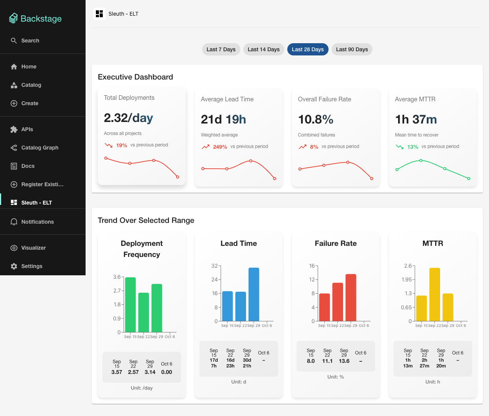
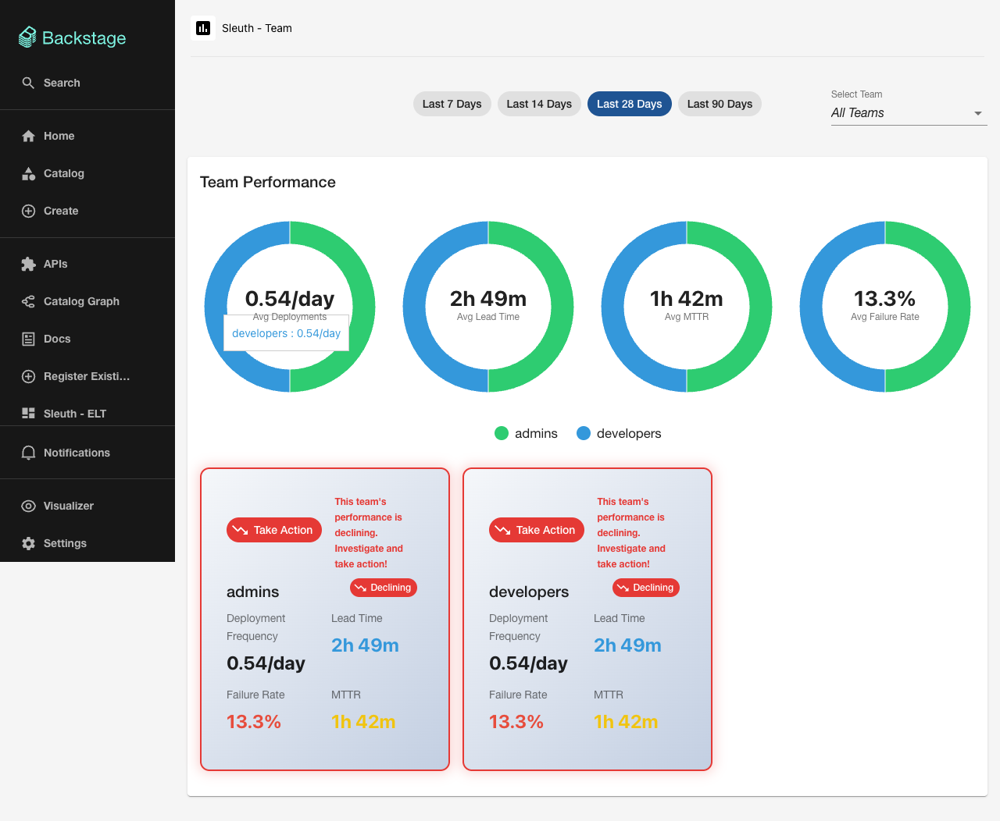
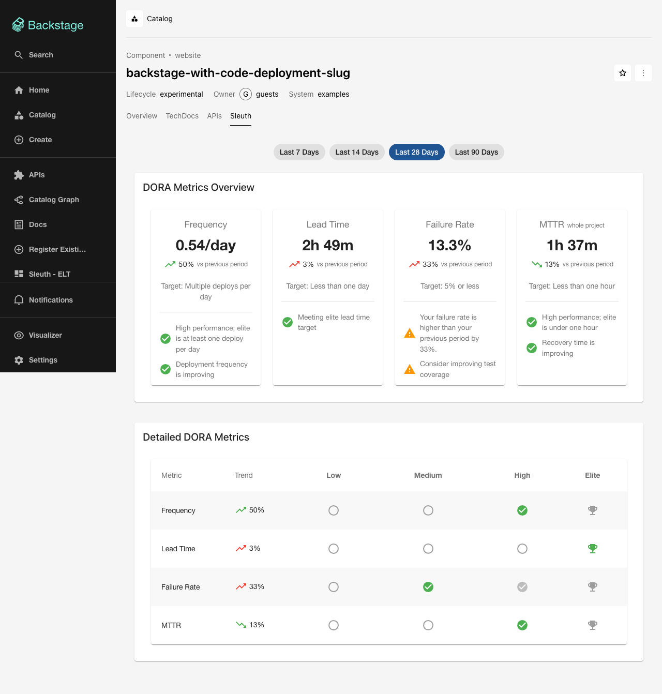
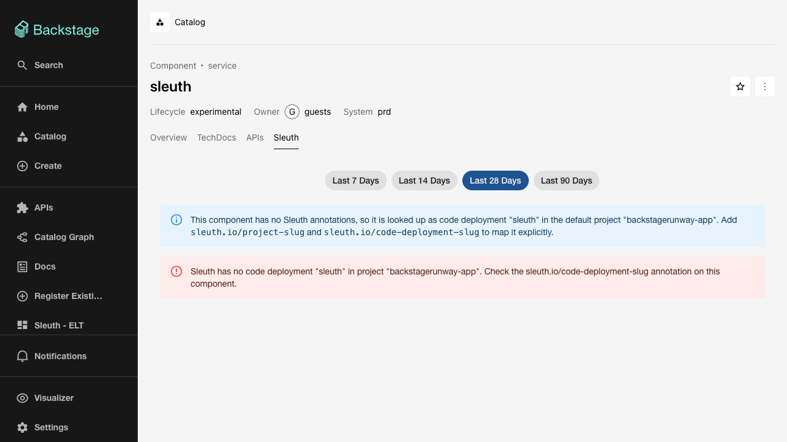

# Sleuth DORA metrics for Backstage

This plugin shows your [Sleuth](https://sleuth.io) delivery metrics inside Backstage, so people can see
how software delivery is going without leaving the place where they already look up services and teams.

It shows the four DORA metrics:

| Metric                     | The question it answers                                         |
| -------------------------- | --------------------------------------------------------------- |
| **Deployment frequency**   | How often do we release to production?                          |
| **Lead time**              | How long does a change take to get from a commit to production? |
| **Failure rate**           | How many of our releases cause a problem in production?         |
| **MTTR** (time to restore) | When something breaks, how long until it is fixed?              |

The numbers come straight from Sleuth. The plugin does not calculate them again, so what you see here
matches what Sleuth shows for the same period.

## The three screens

### For leadership: the whole organisation

One page with the four metrics across every project, how each has changed since the previous period,
and how each moved within the period you picked.



### For team leads: your teams

A card for each team you belong to, with its four metrics and a badge that says whether the team is
improving, stable or declining. A team whose failure rate or lead time got worse is moved to the front
and marked "Take Action".



### For engineers: one service

A "Sleuth" tab on a service or website in the catalog. It shows the four metrics for that one service,
how they changed, how they rate from Low to Elite, and any observation Sleuth itself has made.



New to these screens? [Reading the dashboards](docs/reading-the-dashboards.md) explains every number,
arrow, colour and badge in plain language.

## What you need

- A Backstage app.
- A Sleuth account, with an API key and the short name of your Sleuth organisation (its "slug", the
  part after `app.sleuth.io/` in the address bar).
- Both packages of this plugin. The screens are in `@backstagerunway/plugin-sleuth-dora`. They get their
  numbers from `@backstagerunway/plugin-sleuth-dora-backend`, which is the part that talks to Sleuth and
  keeps your API key out of the browser. One does not work without the other.

## Setting it up

### 1. Install the two packages

```bash
yarn --cwd packages/app add @backstagerunway/plugin-sleuth-dora
yarn --cwd packages/backend add @backstagerunway/plugin-sleuth-dora-backend
```

### 2. Turn on the backend

```typescript
// packages/backend/src/index.ts
backend.add(import('@backstagerunway/plugin-sleuth-dora-backend'));
```

### 3. Tell it about your Sleuth account

```yaml
# app-config.yaml
dora:
  sleuth:
    organizationId: my-org # your Sleuth organisation slug
    apiKey: ${SLEUTH_API_KEY} # keep the key in an environment variable, not in the file
    environment: production # which Sleuth environment to report on
    defaultProjectSlug: my-project # the Sleuth project to use when a component does not name one
```

Only `organizationId` and `apiKey` are required. Every setting is described in
[CONFIGURATION.md](CONFIGURATION.md).

### 4. Add the screens to your app

**If your app uses the new frontend system**, add the plugin as a feature. The two pages, their sidebar
entries and the Sleuth tab appear on their own.

```typescript
// packages/app/src/App.tsx
import { createApp } from '@backstage/frontend-defaults';
import { doraFrontendPlugin } from '@backstagerunway/plugin-sleuth-dora';

export default createApp({
  features: [doraFrontendPlugin],
});
```

**If your app uses the legacy frontend system**, add each piece by hand.

```tsx
// packages/app/src/App.tsx — the two pages
import { DoraELTPage, DoraLeadPage } from '@backstagerunway/plugin-sleuth-dora';

<Route path="/dora-elt" element={<DoraELTPage />} />
<Route path="/dora-team" element={<DoraLeadPage />} />
```

```tsx
// packages/app/src/components/Root/Root.tsx — the sidebar entries
<SidebarItem icon={DashboardIcon} to="dora-elt" text="Sleuth - ELT" />
<SidebarItem icon={AssessmentIcon} to="dora-team" text="Sleuth - Team" />
```

```tsx
// packages/app/src/components/catalog/EntityPage.tsx — the Sleuth tab
import {
  DoraPerformanceComponent,
  isSleuthDoraAvailable,
} from '@backstagerunway/plugin-sleuth-dora';

<EntityLayout.Route path="/sleuth" title="Sleuth" if={isSleuthDoraAvailable}>
  <DoraPerformanceComponent />
</EntityLayout.Route>;
```

## Linking a component to Sleuth

The Sleuth tab appears on catalog components of type `service` or `website`. To show the right numbers
it needs to know which Sleuth project and which code deployment the component is. You say so with
annotations in the component's `catalog-info.yaml`:

```yaml
metadata:
  name: payments
  annotations:
    sleuth.io/project-slug: my-project # the Sleuth project
    sleuth.io/code-deployment-slug: payments-api # the code deployment inside that project
    sleuth.io/environment: production # only if it differs from the app-wide setting
```

All three are optional. When one is missing, the plugin falls back like this:

| Value           | First choice                     | Otherwise                              | Otherwise    |
| --------------- | -------------------------------- | -------------------------------------- | ------------ |
| Project         | `sleuth.io/project-slug`         | `defaultProjectSlug` in the app config | `sleuth`     |
| Code deployment | `sleuth.io/code-deployment-slug` | the component's own name               |              |
| Environment     | `sleuth.io/environment`          | `environment` in the app config        | `production` |

A component with neither a project nor a code deployment annotation still gets a tab, with a notice
saying which names were assumed. If Sleuth has no code deployment by that name, the tab says so and
tells you which annotation to check.



## Linking teams to Sleuth

The team screen shows the teams the signed-in person belongs to. It reads them from that person's user
entry in the Backstage catalog (the `memberOf` list) and asks Sleuth for a team with the same name.

So for a team to appear, **the Backstage group name must be the same as the Sleuth team's slug**. A
group that Sleuth does not know is left out. If Sleuth knows none of a person's groups, the screen shows
an error instead of empty cards.

## When something looks wrong

| What you see                                         | What it means                                                                          | What to do                                                                          |
| ---------------------------------------------------- | -------------------------------------------------------------------------------------- | ----------------------------------------------------------------------------------- |
| "Sleuth DORA plugin is not configured: … is not set" | The backend has no API key or organisation                                             | Set `dora.sleuth.apiKey` and `dora.sleuth.organizationId`, then restart the backend |
| "Sleuth has no code deployment "x" in project "y""   | The component points at a deployment Sleuth does not have                              | Fix `sleuth.io/code-deployment-slug` on the component                               |
| "This component has no Sleuth annotations…"          | The component's own name was used as the deployment name                               | Add the annotations above, unless the names already match                           |
| "No deployments recorded in Sleuth…"                 | Nothing was released in the period                                                     | Pick a longer period; this is information, not a fault                              |
| "Failed to query Sleuth API: …"                      | Sleuth refused or could not be reached; the rest of the message is Sleuth's own reason | Check the API key, the organisation slug, the project and the environment names     |
| "No teams found for your user account"               | Your catalog user belongs to no group                                                  | Add `memberOf` to your user entry                                                   |
| "Failed to load user teams: No user entity found"    | You are signed in but have no user entry in the catalog                                | Add a user entry for yourself                                                       |
| The numbers look out of date                         | Answers from Sleuth are kept for five minutes                                          | Wait, or lower `cacheTtlSeconds`                                                    |

## Working on the plugin

```bash
yarn install
yarn start       # the app on localhost:3000 and the backend on localhost:7007
yarn test        # unit and screen tests
yarn test:e2e    # the three screens in a real browser, with fixed figures and no API key needed
```
